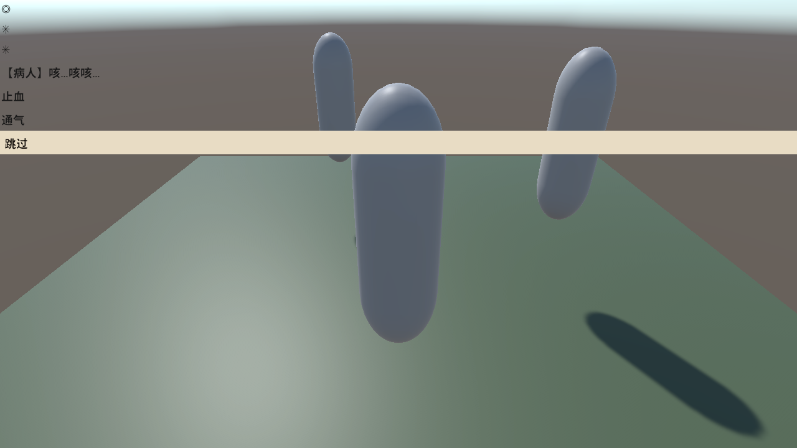
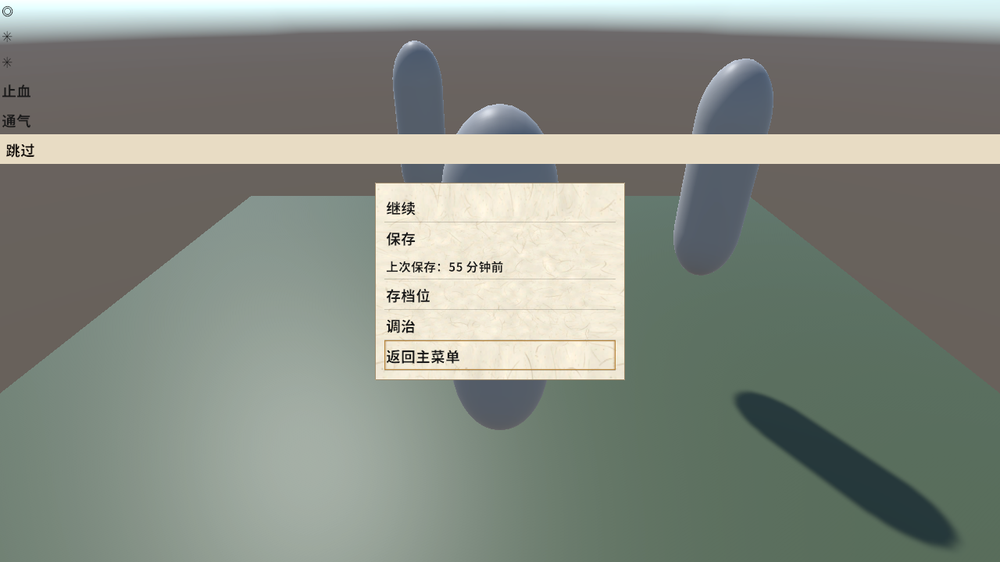

# `TD-build-03` 兑现轮 —— 占位材质改「资产驱动」,打包版病人恢复可见

| 字段 | 值 |
|---|---|
| **日期** | 2026-11-05(晚) |
| **用户指令** | 「按①把着色器那条也修了」(① = `TD-build-03` 解除动作的「资产驱动」) |
| **三元组** | 截至 `2026-11-05 19:11 CST` · 批次 `TD-build-03 兑现轮` · commit `93594d1f` + 工作树 |

---

## 1. 病根(一句话)

生产码在**运行期**用 `Shader.Find("Universal Render Pipeline/Lit")` 取着色器,而**没有任何资产引用它**
⇒ player 构建把它当未使用**剥离** ⇒ 打包版每次取都 null ⇒ 工厂按设计抛异常
⇒ **打包版里一个病人都画不出来**(旧包日志 `找不到 URP Lit` **1442 / 1676** 条,两个不同轮的日志)。

编辑器与 EditMode **永远看不见**这件事:编辑器有全量着色器库,`Shader.Find` 恒成功。

## 2. 改了什么(三件)

| # | 文件 | 内容 |
|---|---|---|
| ① | `unity/Assets/Gameplay.Presentation/Patients/Resources/PatientPlaceholderMaterial.mat`(**新资产**) | URP Lit 材质,`_BaseColor = (0.7, 0.7, 0.7, 1)`。住 `Resources/` ⇒ 必进包;**其依赖(URP Lit 着色器)随资产引用进包**。 |
| ② | `unity/Assets/Gameplay.Presentation/Patients/CapsulePatientVisualFactory.cs` | `CreatePlaceholderMaterial()`(运行期 `Shader.Find` + `new Material`)→ `LoadPlaceholderMaterial()`(`Resources.Load<Material>`,加载不到**抛**)。删除 `NeutralGrey` 常量 —— 色值的唯一真源移到 `.mat`。 |
| ③ | `unity/Assets/Editor.Tools.Bake/Cli/CreatePatientPlaceholderMaterialCli.cs`(**新工具**) | 资产出处(可复跑)。**资产已存在即失败**(`Exit(2)`)—— 只能创建、不能覆盖,故它不会成为第二个色值真源。 |

**工厂里"不得加回 `Shader.Find`"是判据,不是偏好**:加回去之后,「资产丢了」这一形态在编辑器
与夹具里**完全隐身**(内置 shader 恒在),只在打包版发作 —— 那正是本缺陷活了这么久的机制。

## 3. 判据(夹具 `patient_visual_seams_test.cs` 7 条)

原 `test_placeholderMaterial_urpLitFirst_andLoudFailOnBothMissing` 守的是**已被推翻的实现形态**
(`URP Lit 先于 Standard` 的查找次序),同批改写为
**`test_placeholderMaterial_comesFromAsset_notRuntimeShaderFind`**,判据分两层:

| 层 | 断言 | 判别力 |
|---|---|---|
| **行为层(主判据)** | `Resources.Load<Material>("PatientPlaceholderMaterial")` 非 null;`asset.shader` 非 null;`asset.shader.name == "Universal Render Pipeline/Lit"` | 资产被删 / 移出 Resources / 换 shader ⇒ 当场红 |
| **源码层** | 去注释后的工厂源码:`Resources.Load<Material>` **在场**、`"PatientPlaceholderMaterial"` **在场**、`Shader.Find` **不在场**(负判据)、`throw new System.InvalidOperationException` **在场** | 任何人把运行期查找加回来 ⇒ 红 |

原有的 `test_placeholderVisual_materialIsNeutralGrey_notMagentaColor` 走**真实生产路径**
(`factory.Create(1)` → `Renderer.sharedMaterial`),本次起它的判别力变强:资产缺失会在
`Create` 里**当场抛**,不再只是「挂着 + 色对 + 非品红」。

## 4. 证伪轮(3 变异,各自红在靶点;SHA-256 逐字节还原)

| 变异 | 做法 | 结果 |
|---|---|---|
| **M1** 资产消失 | `.mat` 在同目录改扩展名(`.mat.off`),保住 `.meta` 与 GUID | **3 红**:`..._comesFromAsset_notRuntimeShaderFind` + `..._materialIsNeutralGrey_notMagentaColor` + `..._destroy_isIdempotentAndNullTolerant`(后两条因 `Create` 抛而连带)。`sha256` 还原一致 |
| **M2** 加回 `Shader.Find` | 在工厂里插一行 `var _probe = Shader.Find("Universal Render Pipeline/Lit");` | **1 红**:恰为源码层那条。`sha256` 还原一致 |
| **M3** 静默失败 | 把 `throw` 整块换成 `if (mat == null) return null;` | **1 红**:恰为源码层的 `throw` 断言。`sha256` 还原一致 |

M2 / M3 的连带为 0 —— 两条源码判据互不借绿。

## 5. 真包 A/B(这是本条债唯一的有效判据)

```bash
# 出包（仓库 CLAUDE.md 的 batch 约定；-projectPath 必须指向 unity/）
cd unity && ~/Unity/Hub/Editor/6000.3.24f1/Editor/Unity -batchmode -quit -nographics \
  -projectPath "$PWD" \
  -executeMethod DaYiJingCheng.EditorTools.Bake.Cli.CostTableProbeBuildCli.Build \
  -logFile Logs/probe-build-tdbuild03.log
# ⇒ Build Finished, Result: Success. / 错误数 = 0;耗时 24.09 s

# 跑真包（图形模式，不带 -batchmode）
DISPLAY=:0 ./CostTableProbe.x86_64 -screen-fullscreen 0 -screen-width 1280 -screen-height 720

# 判据
grep -c "找不到 URP Lit" ~/.config/unity3d/DefaultCompany/unity/Player.log
```

| | 旧包 | 新包 |
|---|---|---|
| `grep -c "找不到 URP Lit"` | **1442**(`plog5.txt`)/ **1676**(`rm2.txt`) | **0** |
| 世界里看得见病人 | **否** | **是**(3 个灰蓝胶囊,见下图) |




**着色器 GUID 实证**(`.mat` 按 GUID 引用,不按名字 —— 债册原文那条「`grep` 名字零命中」的检查
其实**看不见引用**,这一点本轮如实登记):

```bash
grep "m_Shader" unity/Assets/Gameplay.Presentation/Patients/Resources/PatientPlaceholderMaterial.mat
#   m_Shader: {fileID: 4800000, guid: 933532a4fcc9baf4fa0491de14d08ed7, type: 3}
grep -m1 guid unity/Library/PackageCache/com.unity.render-pipelines.universal@*/Shaders/Lit.shader.meta
#   guid: 933532a4fcc9baf4fa0491de14d08ed7      ← 同一个
```

## 6. 回归

| 套件 | 结果 | 对照 |
|---|---|---|
| EditMode | **`6940 / 6903 / 0 / 0 / 37`**(`ed-tdb03.xml`) | `ed-rm.xml`(`6940 / 6903 / 0 / 0 / 37` @ 2026-11-05 18:06 · `3621f51b`)—— **逐位相同** |
| PlayMode | **`341 / 337 / 0 / 2 / 2`**(`pm-tdb03.xml`) | 同上基线 —— **逐位相同**(2 条 Inconclusive 是既有 `NOT-RUN` 登记) |

⚠️ **本轮测试数零增减**:被改写的那条是**替换**不是新增(7 → 7)。
⚠️ **不要拿 `6915 / 6878` 当基线**:那是 2026-11-05 早些时候某轮的读数,与本次全量命令**口径不同**
(本次与 `ed-rm.xml` 同为 6940/6903)。**本条如实登记,不把两个口径混读成「零回归」的证据链**。

## 7. 未做 / 边界(禁借绿)

1. **玩家真实存档目录被本轮的调试跑局写过一次,已还原**:跑真包期间 `w4/` 新增 `save_17.bin`、
   覆写 `save_exit.bin`(+`.bak`)、`worlds.index` 变化;`diff -rq` 对备份逐件还原后
   **`diff` 零输出**(备份留 `/tmp/dyjc-costtable-probe/saves.old4`,`/tmp` 清理后即失效)。
2. **`GraphicsSettings → Always Included Shaders` 未动**(那是解除动作 ②,被 ① 取代);
   故若将来有**第二处**运行期手搓材质,同样的问题会重来 —— 但届时 `grep "Shader.Find"` 有判据可查。
3. **`TD-build-02`(零正式构建入口)不受本修复影响**:本条是用**探针 CLI** 出的包,
   正式构建入口仍缺。
4. **占位材质的视觉仍是灰盒**(`p0-sweep-2026-10-29.md:308`),真资产兑换不受影响;
   兑换时**多一个要一起删的资产**(`PatientPlaceholderMaterial.mat` + 本轮的生成器)。
